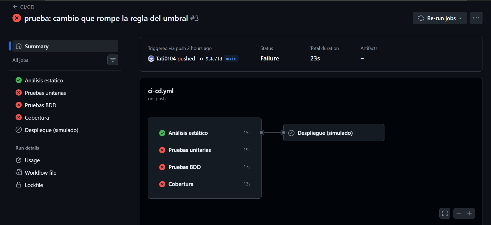
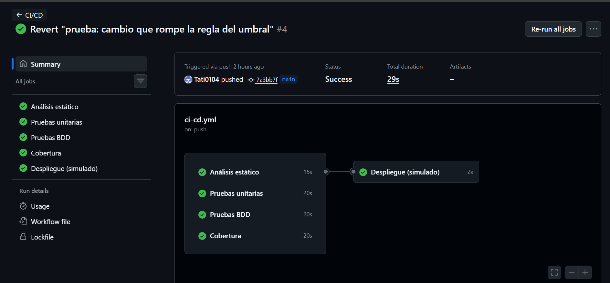
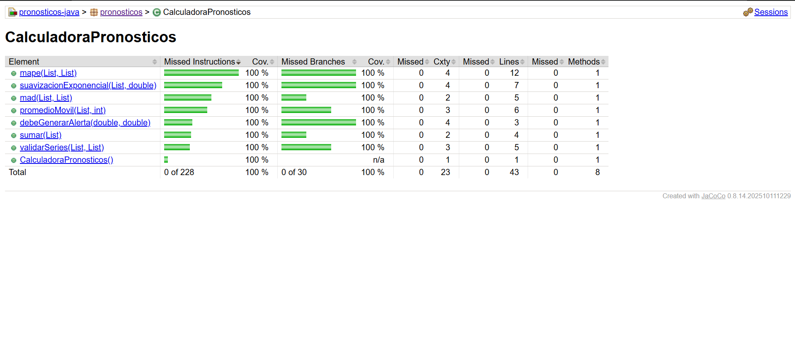

# Informe · Pruebas de la Unidad 2 y pipeline de CI/CD

**Estudiante:** Tatiana Chavez

## 1. Repositorio

https://github.com/Tati0104/pronosticos-java-Chavez

## 2. Pipeline en rojo y en verde

**Rojo (Paso 7.5):** se cambió `>=` por `>` en `debeGenerarAlerta`.
Ejecución: https://github.com/Tati0104/pronosticos-java-Chavez/actions/runs/43123639599

**Verde (después del `git revert`):**
Ejecución: https://github.com/Tati0104/pronosticos-java-Chavez/actions/runs/43123734461

## 3. Reporte de JaCoCo

`CalculadoraPronosticos` quedó con 100 % de cobertura de líneas (43 de 43) y 100 % de ramas (30 de 30).

## 4. Preguntas

**¿Qué vieron en el rojo del Paso 2.1 y por qué en Java suele ser un error de compilación?**

Al correr las pruebas salió `COMPILATION ERROR` con `cannot find symbol` sobre el método `suavizacionExponencial`. La prueba llamaba a un método que todavía no existía en `CalculadoraPronosticos`. Java es un lenguaje compilado y con tipos estáticos: antes de ejecutar cualquier prueba, el compilador revisa que cada método que se usa exista con esa firma. Como no existía, el código de prueba ni siquiera se pudo compilar, y por eso el rojo fue un error de compilación y no una prueba fallida.

**¿Por qué el MAPE del caso `[80, 0, 95]` se divide entre 2?**

El MAPE expresa cada error como porcentaje de la demanda real, es decir, divide entre la demanda. En el segundo periodo la demanda es 0, y dividir entre 0 no está definido, así que ese periodo se excluye. Solo quedan 2 periodos válidos: el primero con 0 % de error (80 contra 80) y el tercero con 5 / 95 · 100 = 5.26 %. El promedio es (0 + 5.26) / 2 = 2.63. Si se dividiera entre 3, se estaría contando un periodo que no aportó ningún error medible y el resultado saldría más bajo de lo real.

**¿Por qué las pruebas unitarias crean la calculadora con `new` en lugar de levantar Spring?**

Porque `CalculadoraPronosticos` es una clase de Java puro: no tiene anotaciones de Spring ni depende de bases de datos ni de HTTP. Para probar su lógica basta con crear el objeto con `new`. Levantar el contexto de Spring haría las pruebas mucho más lentas y mezclaría la lógica de negocio con la configuración del framework. Así cada prueba es rápida, aislada y, si falla, se sabe que el problema está en el cálculo y no en otra parte.

**¿Qué diferencia hay entre una prueba unitaria y un escenario BDD en este proyecto?**

La prueba unitaria (por ejemplo `AlertasTest`) está escrita en Java, para programadores, y verifica un método directamente con valores concretos. El escenario BDD (`alertas.feature`) está escrito en español con Gherkin (Dado / Cuando / Entonces), de forma que alguien de Producción puede leerlo y confirmar que la regla de negocio es la correcta, por ejemplo que "el error igual al umbral sí alerta". Esa descripción también se ejecuta como prueba gracias a `AlertasSteps`, que conecta cada frase con el código. Las dos terminan llamando a `debeGenerarAlerta`, pero la unitaria se enfoca en el código y el BDD en el comportamiento que espera el negocio.

**En el Paso 7.5, ¿qué pruebas fallaron y por qué el despliegue no corrió?**

Fallaron las pruebas del caso límite, donde el error es exactamente igual al umbral (10 contra 10):

- `AlertasTest.alertaCuandoElErrorEsIgualAlUmbral` (en el job de Pruebas unitarias): `expected: <true> but was: <false>`.
- El escenario "El error es igual al umbral" (en el job de Pruebas BDD).
- El job de Cobertura también falló, porque `mvn verify` corre todas las pruebas, incluidas esas dos.

Con `>`, 10 > 10 es falso, así que ya no se generaba la alerta. Análisis estático pasó, porque el código seguía bien escrito. El despliegue quedó como *skipped* porque tiene `needs: [analisis-estatico, pruebas-unitarias, pruebas-bdd, cobertura]`, y solo corre si los cuatro terminan bien. Como tres fallaron, el cambio defectuoso no llegó a "producción".
